<p align="center">
  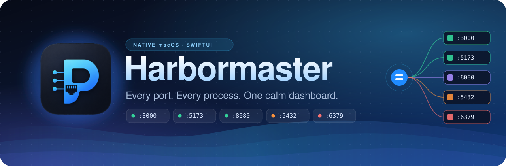
</p>

<p align="center">
  <b>English</b> &nbsp;·&nbsp;
  <a href="https://github.com/an6122003/harbormaster-vi">Tiếng Việt</a> &nbsp;·&nbsp;
  <a href="https://github.com/an6122003/harbormaster-zh">简体中文</a>
</p>

<p align="center">
  
  
  
  
  <a href="LICENSE"></a>
</p>

Harbormaster is a native macOS app that answers one question: what is running on my ports? It lists every listening TCP port, shows which process owns it and what it serves, previews the page inside the app, and stops the process when you are done with it.

After a few hours of local development there are usually more servers running than you remember starting: a couple of Next.js or Vite apps, an API, a database, something left over from last week. `lsof -i :3000` answers one question at a time. Harbormaster shows the process, the page title, the memory use and the terminal that started it in one window, with a stop button next to each.

<p align="center">
  <a href="docs/screenshots/hero.jpg">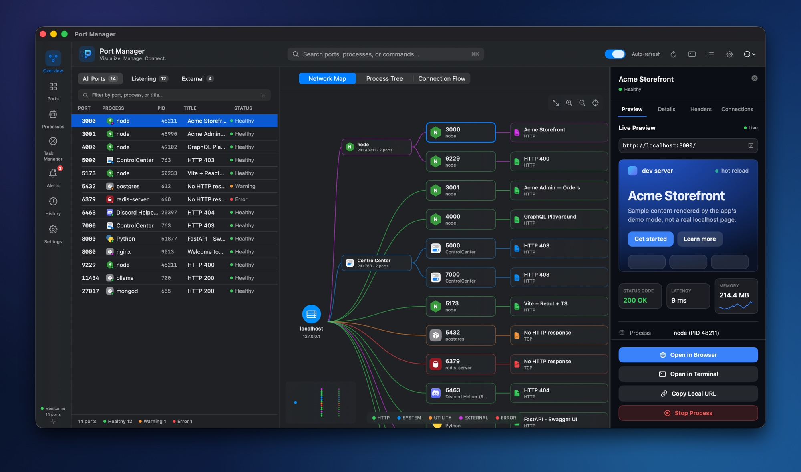</a>
</p>

> The screenshots in this README were taken in the app's demo mode, which shows made-up sample data instead of your machine (see [Demo mode](#demo-mode)). Click any of them for the full-size image. The app itself is still called Port Manager; Harbormaster is the project name.

## Install

You need macOS 13 (Ventura) or newer and a Swift 5.10 toolchain (Xcode 15.3 or later, or the matching command line tools).

```bash
git clone https://github.com/an6122003/harbormaster.git
cd harbormaster
./scripts/build-app.sh
open "build/Port Manager.app"
```

The script builds a release binary, assembles `build/Port Manager.app` and signs it ad hoc. To keep the app, copy it to Applications:

```bash
cp -R "build/Port Manager.app" /Applications/
```

There is no prebuilt download, because the app is only ad-hoc signed and not notarized. A copy you build yourself has no quarantine flag, so macOS opens it without a Gatekeeper prompt.

`swift run` also works for development. The logo and the menu bar glyph fall back to a generic box symbol there, because the images are only copied into the packaged app.

### Permissions

The first time you use Open in Terminal, macOS asks whether the app may control Terminal.app or iTerm2 (Automation). That is the only permission prompt. The app runs as your user and never asks for admin rights, so it sees the sockets your account can see. Listeners owned by other users, such as root daemons, do not appear in the port list.

## Features

| Feature | What it does |
| --- | --- |
| Port dashboard | Every listening TCP port with its process, PID, page title and status. Filter by All Ports, Listening (answered HTTP) or External (bound to all interfaces), or search with ⌘K. |
| Network map | localhost, the processes behind it and each port's page title, drawn as a graph. Ports that share a PID hang off one process node. Scroll to pan, pinch to zoom. |
| Process tree and connection flow | For the selected port: the chain of parent processes from launchd down to the server, and the TCP connections open on the port. |
| Live preview | Renders the selected port's page inside the app, next to its status code, response time and a memory sparkline. |
| Process details | Command line, working directory, start time, uptime, user, `NODE_ENV`, runtime version, response headers, and the local and LAN URLs. |
| Open in Terminal | Jumps to the Terminal.app or iTerm2 tab that started the process. For other terminals and editors (VS Code, Warp, Ghostty and so on) it offers to bring the app to the front. |
| Bulk actions | ⌘-click or Shift-click to select several ports, then stop or force quit them together. |
| Task manager | Every process on the Mac with CPU, memory, threads and user. Sort by any column, filter, stop. |
| Other dev processes | node, Python and similar processes that use memory but hold no port, such as a dev server that lost its listener. |
| Alerts and history | Flags ports that stop answering and keeps a session log of stops, force quits, terminal reveals and recoveries. |
| Menu bar | The port list in a popover, with open, reveal and stop buttons on each row. |

## Walkthrough

### Check a service before you stop it

Select a port and the panel on the right opens. `Preview` renders the page. `Details` lists the process, the local URL and, when the port listens on all interfaces, the LAN URL. `Headers` shows the response headers and `Connections` lists the open TCP connections. The buttons at the bottom are Open in Browser, Open in Terminal, Copy Local URL and Stop Process. Stop asks for confirmation, and a right-click on it offers Force Quit.

<p align="center">
  <a href="docs/screenshots/details.jpg">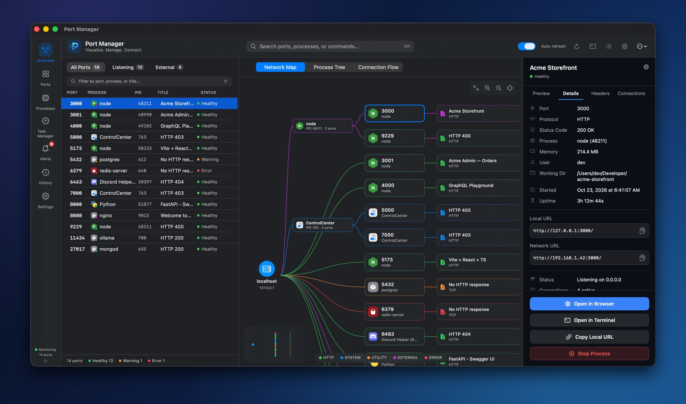</a>
</p>

### See what started a process

Process Tree walks from the server up to launchd. In the sample data, this `next-server` was started by `npm run dev` in a login shell. Connection Flow lists the TCP connections open on the port, with the remote address and state of each.

<p align="center">
  <a href="docs/screenshots/process-tree.jpg">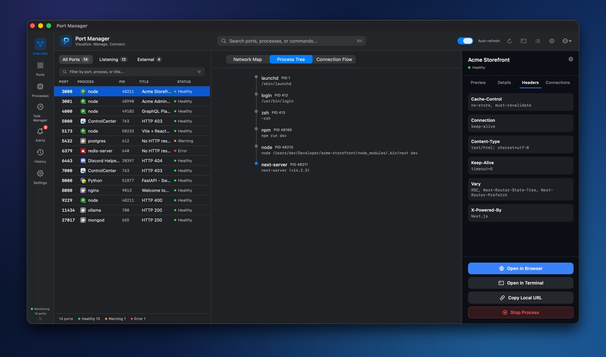</a>
</p>

<p align="center">
  <a href="docs/screenshots/connection-flow.jpg">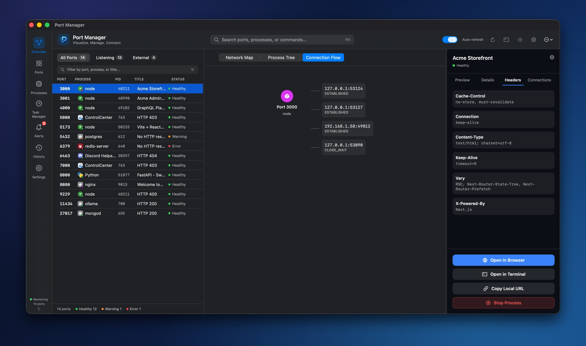</a>
</p>

### Stop several at once

Select rows and a bar appears under the list with Stop All. The ⋯ menu next to it has Force Quit All. Both ask for confirmation first.

<p align="center">
  <a href="docs/screenshots/bulk-select.jpg">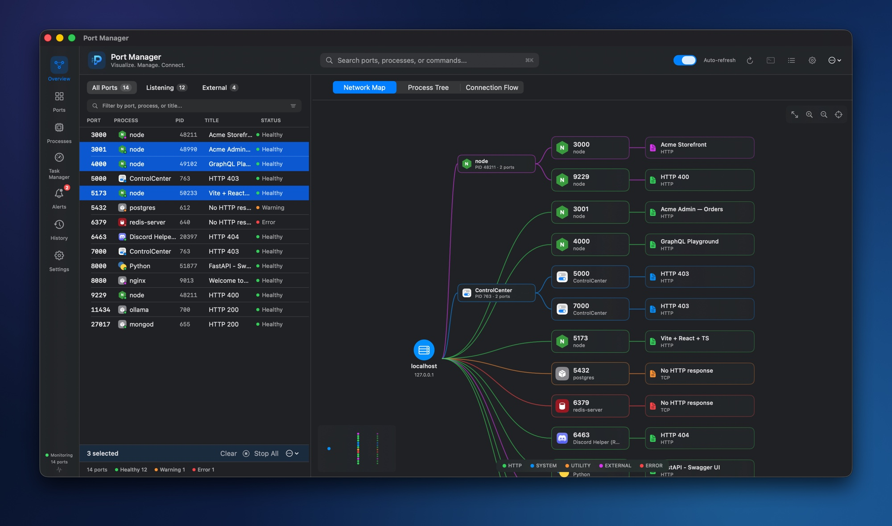</a>
</p>

### Find memory that no port is advertising

Harbormaster finds processes through listening sockets, so a dev server that lost its listener but left its workers running never shows up in the port list. The Processes tab has an Other Dev Processes section for that case. It lists processes whose executable path contains node, next-server, npm, yarn, pnpm, python, ruby, deno, bun, java, webpack, vite, turbopack, ts-node or nodemon, that use at least 30 MB and hold no port. The largest come first, up to 15.

<p align="center">
  <a href="docs/screenshots/hidden-processes.jpg">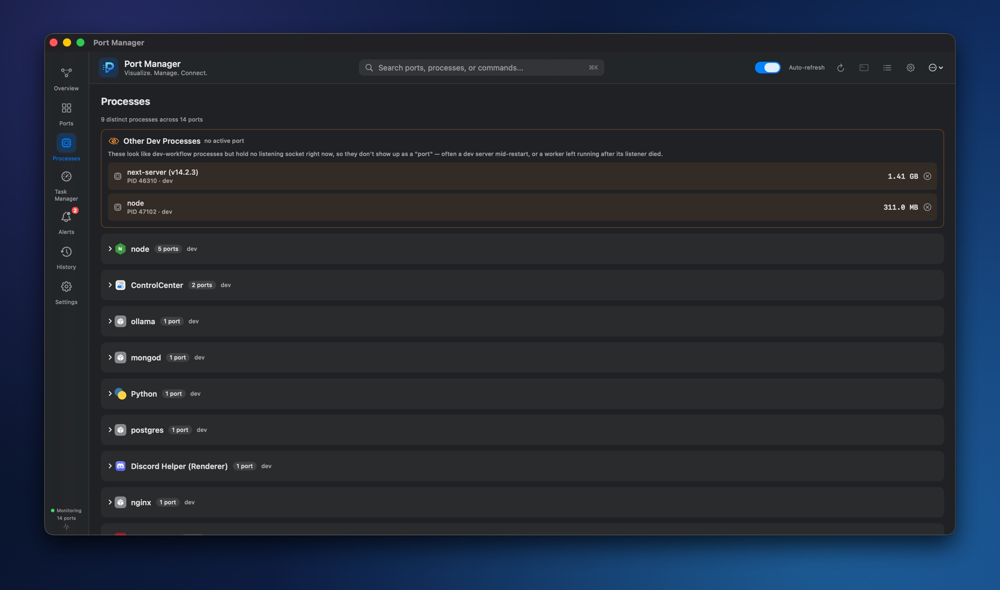</a>
</p>

### A task manager for the rest

Click a column header to sort. Memory is `phys_footprint`, the measure behind Activity Monitor's Memory column, read through libproc for processes you own. macOS refuses that call for other users' processes, so for those the app falls back to resident size and shows a dash for Threads. The list refreshes every 2.5 seconds while the tab is open and stops polling when you leave it. Stop asks for confirmation, and a right-click offers Force Quit.

<p align="center">
  <a href="docs/screenshots/task-manager.jpg">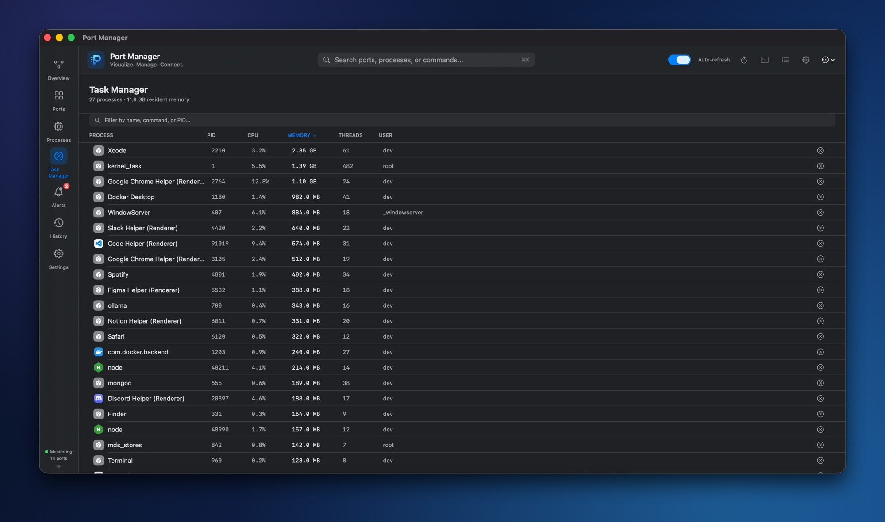</a>
</p>

### In the menu bar

<table>
  <tr>
    <td width="42%"><a href="docs/screenshots/menu-bar.jpg">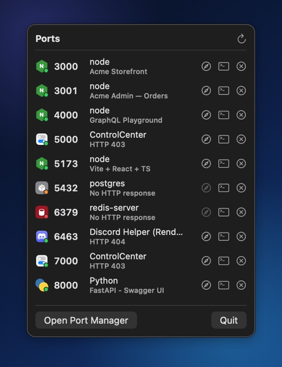</a></td>
    <td valign="middle">
      The popover lists every port. Each row has three buttons: open in the browser (disabled when the port does not answer HTTP), reveal the terminal and stop. Stop here sends SIGTERM straight away, with no confirmation. Open Port Manager brings up the full window.
    </td>
  </tr>
</table>

### Alerts and history

Alerts lists the ports that are in Warning or Error, plus the recent changes. A red badge on the sidebar icon shows the count. History logs stops, force quits, terminal reveals and alert changes, and Clear empties it. Both are kept in memory, up to 200 entries, and reset when you quit. Ports that were already failing when the app started are not reported as new alerts.

<p align="center">
  <a href="docs/screenshots/alerts.jpg">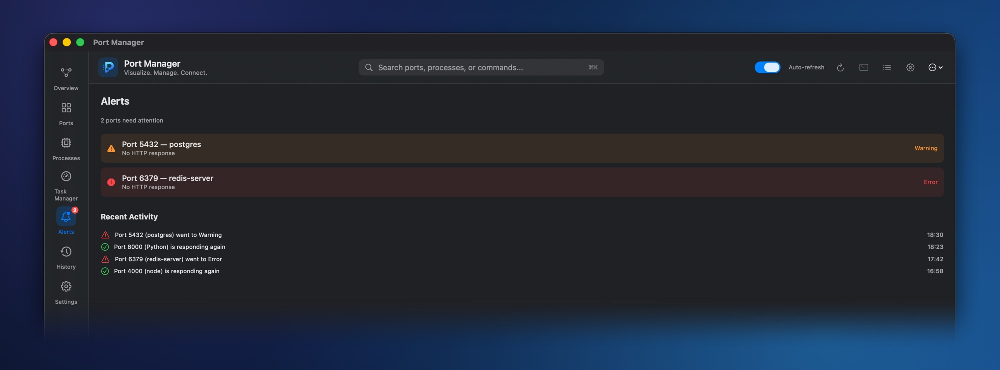</a>
</p>

<p align="center">
  <a href="docs/screenshots/history.jpg">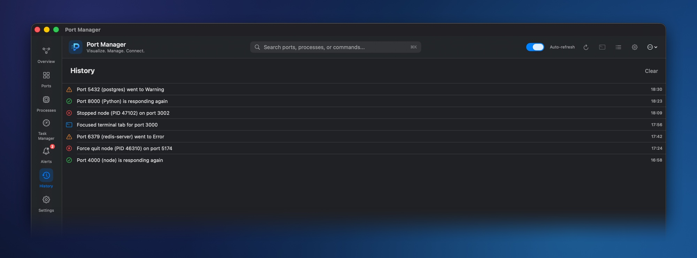</a>
</p>

## Using it

- ⌘K focuses the search field in the top bar. The text filters the port list and the map, and matches the port number, process name, command line and page title.
- Click a row or a map node to select a port. ⌘-click or Shift-click selects several.
- The sidebar has Overview (list, map and detail panel), Ports (list only), Processes, Task Manager, Alerts, History and Settings.
- Drag the dividers to resize the list and the detail panel.
- In the map, scroll to pan, and pinch or use the toolbar to zoom between 40% and 250%. The first toolbar button resets zoom and position, and the last one centers on localhost.
- Stop sends SIGTERM. Right-click a stop button for Force Quit, which sends SIGKILL. The menu bar popover has no force quit.
- Ports refresh every 4 seconds. The Auto-refresh switch in the top bar turns that off, and the refresh button scans once.

## How status is decided

Harbormaster sends one `GET /` to `127.0.0.1:<port>` and gives up after about a second.

| Result | Status |
| --- | --- |
| Any HTTP response, including 404 and 403 | Healthy |
| The request times out | Warning |
| The connection is refused or dropped | Error |

A database or another service that does not speak HTTP therefore shows Warning or Error even when it is running fine. The status tells you whether the port answers HTTP, which is narrower than whether the service is up.

The colors in the map and next to each process icon come from a separate category, checked in this order:

| Color | Category | Rule |
| --- | --- | --- |
| Blue | System | The process name is on a built-in list of macOS daemons, such as ControlCenter, rapportd, sharingd and WindowServer. |
| Red | Error | The connection was refused. |
| Purple | External | The port is bound to all interfaces (`*` or `0.0.0.0`). |
| Green | HTTP | The port answered an HTTP request. |
| Orange | Utility | Everything else, such as a local port that timed out. |

## How it works

| Data | Source |
| --- | --- |
| Listening sockets and connection counts | `lsof -iTCP -n -P` |
| Open connections for one port | `lsof -iTCP:<port>` |
| Command line, user, uptime | `ps` |
| Working directory | `lsof -d cwd` |
| Task manager list, CPU | `ps -axo` |
| Memory footprint and thread count | libproc (`proc_pid_rusage`, `proc_pidinfo`) |
| `NODE_ENV`, terminal and host app detection | `ps eww`, reading a few environment variables and the tty |
| Runtime version | `--version` of node, python, python3, ruby, deno, bun and php, cached per executable |
| Process tree | `ps -o ppid=,comm=`, one hop at a time up to launchd |
| Page title, headers, latency | one `URLSession` request to 127.0.0.1 |
| LAN address | `route -n get default` and `ipconfig getifaddr` |
| Terminal tab | AppleScript against Terminal.app and iTerm2 |
| Live preview | `WKWebView` |
| Stop and force quit | `kill(2)` with SIGTERM or SIGKILL |

There is no daemon and no helper tool. The app runs system tools and sends HTTP requests to 127.0.0.1, and that is all the networking it does. It has no telemetry, no account and no update check. The Preview tab loads your page the way a browser would, so a page that pulls in outside assets still fetches them.

## Demo mode

`--demo` replaces every system probe with made-up sample data. Stop never sends a signal and Open in Terminal does not touch your terminals, so you can click through the whole app without affecting anything real:

```bash
open -n "build/Port Manager.app" --args --demo
```

Setting `PORTMANAGER_DEMO=1` in the environment has the same effect, for example with `swift run`. `--snapshot <dir>` implies `--demo`: it walks through the main screens, saves a PNG of each window into the directory and quits. It captures only the app's own windows, so it needs no Screen Recording permission, and the window is visible on screen while it runs. The images in `docs/screenshots` are these captures set on a gradient background.

## Limits

- Only TCP listeners are shown. UDP is not covered.
- The port list only contains sockets your user can see. Root daemons and other users' listeners are missing, although the task manager still lists their processes.
- The status probe always connects to 127.0.0.1. A server that listens only on IPv6 localhost (`::1`) or on a single LAN address refuses that connection, so it shows Error even if it works in your browser.
- Stop and Force Quit only work on processes your user owns. The app does not check whether the signal was delivered, so History can record a stop that macOS refused.
- Exact-tab reveal works for Terminal.app and iTerm2. Other terminals and editors get an offer to bring the app forward, but only when the app can identify them. Tools that allocate their own pseudo-terminal (nodemon, concurrently, turbo) can defeat the tty match in Terminal.app.
- There is no log viewer. Harbormaster did not start your processes, so it cannot read their output.
- The interface is English only.

## Project layout

```
Package.swift
Sources/PortManager
├── PortManagerApp.swift     main window and menu bar item
├── Models/                  PortInfo, SystemProcessInfo, status and category types
├── Services/                lsof, ps and libproc scanners, process killer, terminal locator
├── ViewModels/              PortListViewModel, the shared state
├── Views/                   sidebar, ports list, network map, detail panel, task manager, …
└── Demo/                    --demo sample data and the --snapshot runner
Resources/                   Info.plist, app icon, menu bar glyph
scripts/
├── build-app.sh             build and assemble "Port Manager.app"
└── make-icon.sh             rebuild AppIcon.icns from the source PNG
docs/                        README banner and screenshots
```

## Contributing

Issues and pull requests are welcome. There are no automated tests yet, so demo mode is the quickest way to check a UI change: run the app with `--demo` and the data is the same every time.

## License

[MIT](LICENSE)
